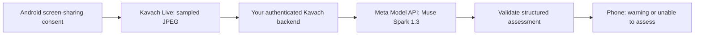

# Kavach Live — Muse Spark through Meta Model API

The Screen mode in version 0.6.0 uses **`muse-spark-1.3` (Standard mode)** through **`https://api.meta.ai/v1/responses`**. This is the hackathon model integration: Muse Spark reads user-consented screen images and assesses visible English text for digital-arrest coercion, isolation, threats and urgent payment demands. It is integrated into the Live Android flow, not just used to generate the app's code.

**Status:** implemented and tested with mocked provider responses; no real Meta API request or physical-device capture has been verified. Credentials remain placeholders. An actual API run is necessary before claiming a demonstrated model-powered result. The previous self-hosted Llama vision adapter has been replaced; no local GPU or vision weights are needed.

## Data flow and model choice



The backend holds the Meta API key. The phone holds only a separate backend access token. Meta is a disclosed second destination; this is cloud processing. No other model provider is used. The Check tab also uses Muse Spark through `/v1/text`; there is no local model runtime. Configure it from the Settings tab.

Official references checked on 3 November 2026:

- [Meta quickstart](https://dev.meta.ai/docs/quickstart): API origin, authentication and Muse Spark model ID.
- [Image understanding](https://dev.meta.ai/docs/image-understanding): inline base64 JPEG `input_image` support.
- [Responses protocol](https://dev.meta.ai/docs/protocols/responses): output structure, `store: false`, reasoning effort and output token bounds.
- [Muse Spark](https://dev.meta.ai/models/muse-spark): multimodal model and Standard/Contributor distinction.

Muse Spark fits the task because it can read screenshot text and assess its context. Muse Image generates images; SAM segments objects; neither is needed to decide whether visible language is coercive. Muse Voice Transcribe cannot grant access to another app's protected call audio. Speakerphone mode now invokes Muse Voice Transcribe for ordinary microphone clips; Muse Image and SAM are not invoked. The application remains English-only for live assessments as a prototype scope choice, not a claim that Muse Spark supports only English.

## Backend setup — placeholders only

Use Python 3.11+:

```sh
python3 -m venv live_server/.venv
. live_server/.venv/bin/activate
pip install -r live_server/requirements.txt
```

Only Pillow is required beyond Python's standard library. No torch, Transformers, OpenAI SDK or GPU is required. HTTPS requests go directly to Meta; endpoint/model cannot be overridden to another provider or Contributor mode.

Copy `.env.example` to a private `.env` and replace its placeholders. Obtain your API key and access/billing through your own Meta account. No account creation or terms acceptance was performed. A single real synthetic text check succeeded on 4 November; image/audio model checks remain unverified.

```dotenv
META_API_KEY=YOUR_META_API_KEY_HERE
KAVACH_LIVE_TOKEN=REPLACE_WITH_RANDOM_TOKEN
KAVACH_BIND=127.0.0.1
KAVACH_PORT=8765
```

Generate a separate backend token with `python3 -c 'import secrets; print(secrets.token_urlsafe(32))'`. Put that token in `.env` and later in the phone. Never put your Meta API key in the APK or the phone's server-token field. The server accepts `MODEL_API_KEY` as an alternative only when `META_API_KEY` is unset/empty. It rejects missing/placeholder keys before startup. It does not automatically read dotenv files; load your own trusted file:

```sh
set -a
. ./.env
set +a
python -m live_server.server
```

After binding successfully, the server immediately prints its listening URL, configured models and a reminder that Meta API access has not been tested. It then waits for app requests; remaining idle is normal. Ctrl+C closes the server and prints a shutdown message. A port already in use produces an explicit startup error. These lifecycle messages contain no keys, images, audio or transcripts.

`GET /health` requires the backend token and reports configured model/provider. **It is not an upstream connectivity check** (`upstream_verified: false`). API errors return unavailable status; there is no fallback model or fabricated verdict.

## One real synthetic API check

After configuring your key, run:

```sh
python -m live_server.smoke
```

This makes **one paid API request** with a generated English image containing fictional coercive phrases. It prints the actual response ID/model, assessment status and risk, but no key or image. It exits unsuccessfully on invalid/unavailable output. This is the quickest way to verify access before the phone demo; one response is not an accuracy evaluation. The command has not been run against Meta during implementation.

## Build and connect the phone

```sh
./tools/android.sh :app:assembleLiveDebug :app:assembleOfflineDebug
.tooling/sdk/platform-tools/adb install -r app/build/outputs/apk/live/debug/app-live-debug.apk
.tooling/sdk/platform-tools/adb reverse tcp:8765 tcp:8765
```

In Kavach Live **Settings**, enter `http://127.0.0.1:8765` and your **server token**, then tap **Connect**. Debug builds permit loopback HTTP for USB forwarding; images leave the phone for your computer, then travel over verified HTTPS to Meta. The backend needs Internet access.

For a remote backend use an HTTPS origin and a certificate trusted by Android's system trust store. Set `KAVACH_TLS_CERT` and `KAVACH_TLS_KEY`; non-loopback serving requires TLS. Release clients require HTTPS even on loopback. No public deployment is supplied.

Install the matching 0.6.0 app and server together: old responses with a Llama model or snapshot revision are rejected. Packages `in.kavach.live` and offline `in.kavach` can coexist. Both require arm64 Android 12+.

## Demonstrate the real-world workflow

1. Start the configured backend and verify the synthetic API check.
2. Connect in **Settings**, then open **Live → Screen → Review live sharing**.
3. Review both destinations (your backend and Meta), possible API charges, sensitive screen content and the ten-minute limit. Cancel sends nothing.
4. Allow notifications and Android's screen-sharing chooser. On Android 14+, choose only the intended app where available. Whole-screen sharing can expose unrelated content.
5. For a controlled demo, share a screen containing fictional English scam messages. For a call demo, only actually visible text can be assessed. Return to the shared app: capture pauses while Kavach is visible.
6. Observe a warning or abstention. Model-read quotes are explicitly unverified. Use the persistent notification's **Stop sharing**, the Live stop button, Android's controls or Privacy's pause switch to end sharing.

Samples in the original Samples tab are still labeled scripted UI demos; they are not Muse Spark results. Do not use them as evidence of hackathon API usage.

## Privacy and operational limits

- At most one frame every 15 seconds, one request in flight and a ten-minute session; no backlog. Max edge 960 pixels, JPEG limit 750,000 bytes. Results older than 45 seconds or from a stopped/other session are discarded.
- The backend uses Standard `muse-spark-1.3`, `store: false`, no conversation history, no tools/search, low reasoning effort and a 4,096 output-token ceiling. No automatic retries: rate limits, auth errors, refusals, truncation and malformed evidence cannot become a safety verdict. A request timeout does not guarantee cancellation of provider work or charges.
- The app and supplied backend do not intentionally persist images or transcripts. `store: false` disables Responses conversation storage; it is **not a blanket zero-retention guarantee**. Meta's processing/retention terms and any infrastructure you add apply. Standard mode is selected; Contributor mode is not enabled.
- Credentials, images and model output are excluded from backend logs. HTTPS verifies certificates and does not follow redirects. Requests are authenticated before image decoding; backend concurrency and request/response sizes are bounded.
- Stopping invalidates local results and stops capture. It cannot retract an image already sent to your backend or Meta. In-flight generation may finish. No forensic memory-erasure claim is made.
- The app checks English text visible in individual sampled images. It does not identify people, authenticate uniforms/documents, detect deepfakes or establish guilt. Faces and police-like backgrounds alone are not evidence. Evidence matching checks consistency with model-read text, not OCR truth. Hallucination and screenshot prompt injection remain possible.

## Android call-audio boundary (Screen mode)

[Android playback capture](https://developer.android.com/media/platform/av-capture) and [audio-input sharing](https://developer.android.com/media/platform/sharing-audio-input) do not give an ordinary companion reliable access to WhatsApp/Instagram voice-communication audio. This app uses [MediaProjection](https://developer.android.com/media/grow/media-projection) for user-consented visual capture only, with a foreground service and visible notifications. Screen mode does not request microphone access. The Live flavor now also includes a separate opt-in microphone service for [Speakerphone mode](AUDIO.md). No camera, accessibility, overlay or notification-listener access is used.

Screen mode cannot detect spoken-only threats. Speakerphone mode can assess speech actually captured by the microphone, with substantial Android and sampling limitations; see AUDIO.md. Protected screens may be blank. No warning is not a safety guarantee. Phone lock, task removal, revocation, loss of notification visibility or the session limit stops sharing.

## Verification

See [VERIFICATION.md](VERIFICATION.md) for current counts and APK hashes. Tests mock the provider and are not evidence of real inference. Before personal-call use, verify on a physical phone: permission denial/revocation, app-only sharing, rotation, blank screens, notification visibility, lock/unlock, stopping during requests, network failures and stale results. Evaluate real-model false positives/negatives, prompt injection, non-English abstention and latency using synthetic cases first.
